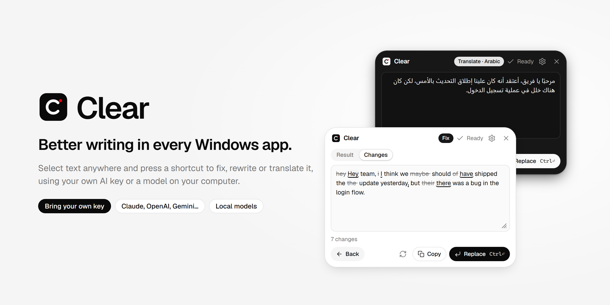
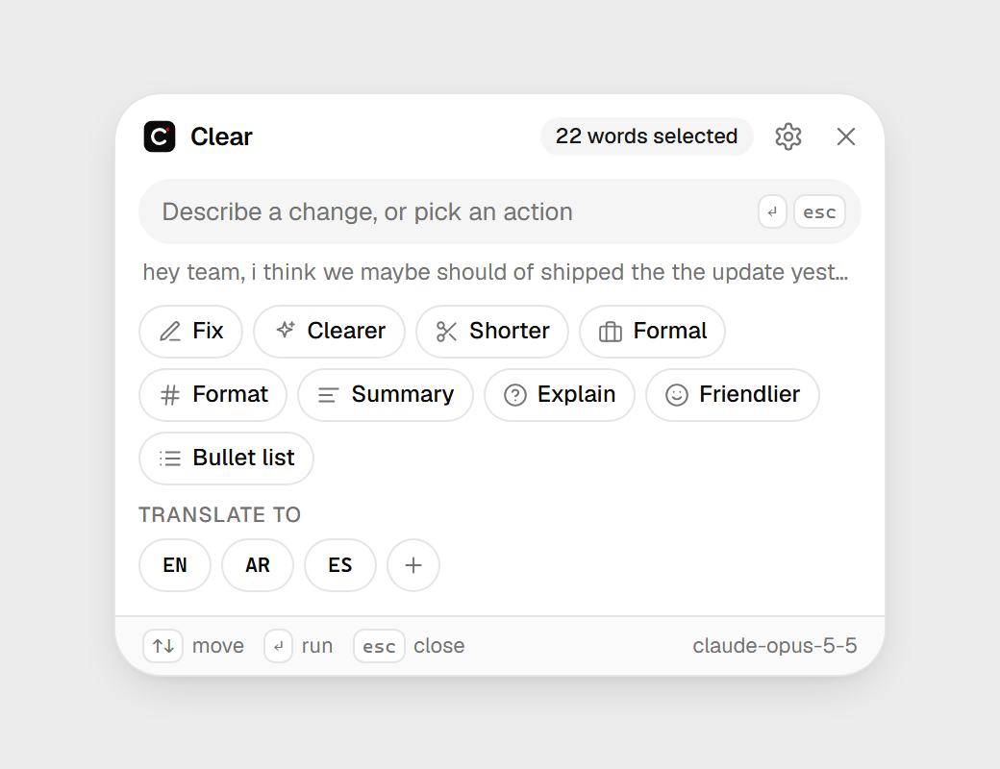
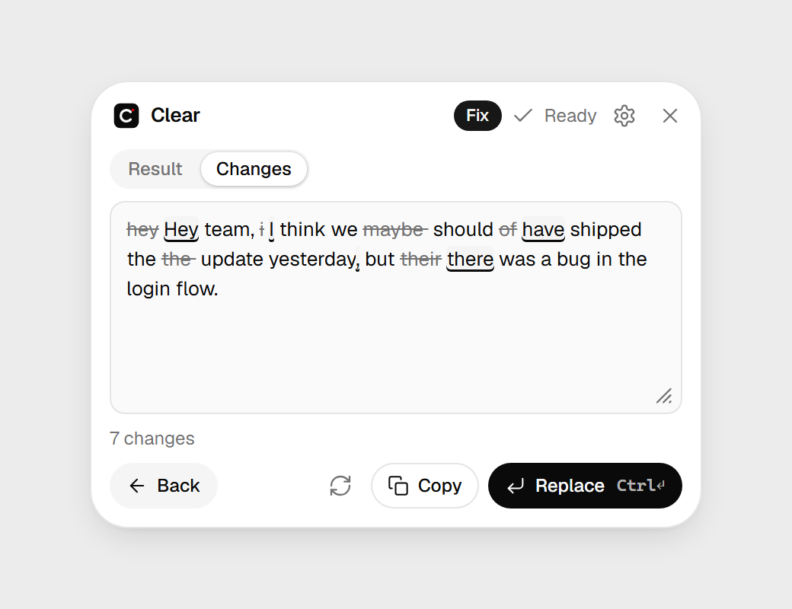
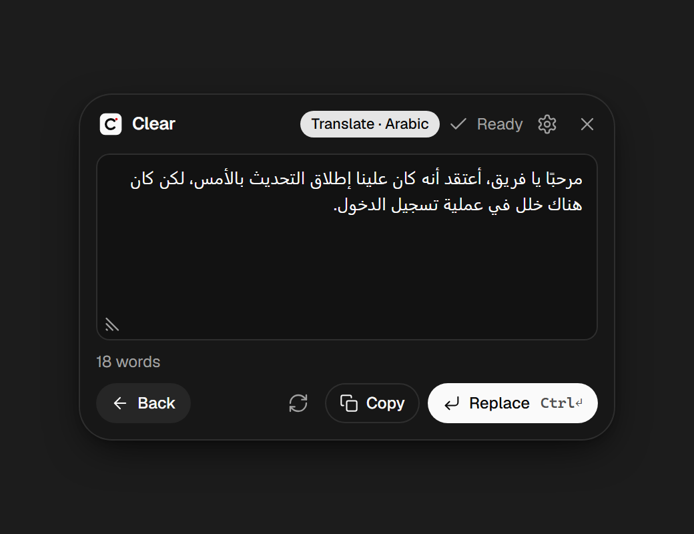
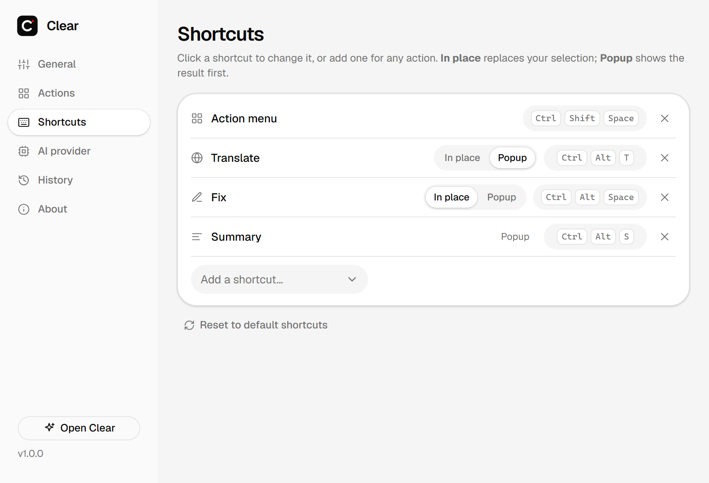
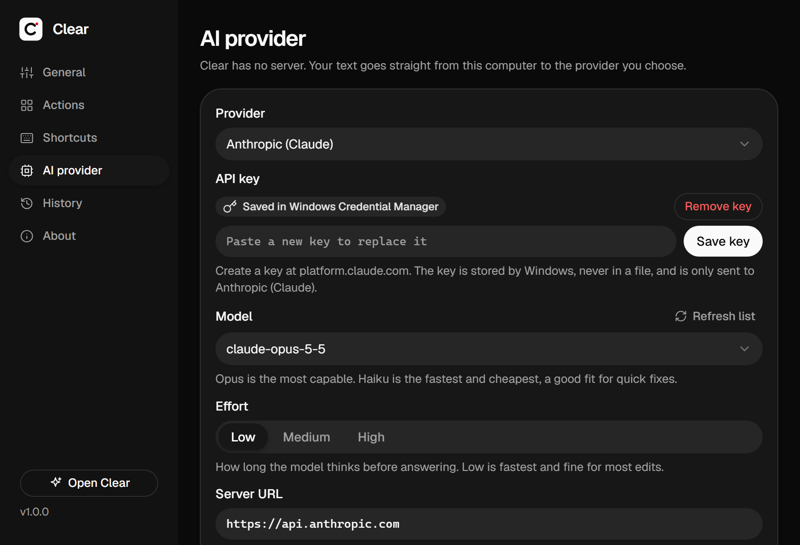

<p align="center">
  
</p>

<p align="center">
  <a href="../../releases/latest"><b>Download for Windows</b></a> ·
  <a href="#getting-started">Getting started</a> ·
  <a href="#what-it-can-do">Features</a> ·
  <a href="#privacy">Privacy</a> ·
  <a href="#build-from-source">Build from source</a>
</p>

# Clear

Clear is a small Windows app that improves your writing wherever you type. Select text in any
app, press a shortcut, and fix, rewrite, shorten or translate it, then put it straight back.

It uses **your own AI provider**: Claude, OpenAI, Gemini, Groq, OpenRouter, Mistral, DeepSeek,
or any OpenAI-compatible server. It can also use a **model on your computer** through Ollama or
LM Studio. Clear has no server and no account: your text goes only to the provider you choose.

The installer is about 2 MB, and Clear sits quietly in the system tray.

## What it can do

<table>
  <tr>
    <td width="50%"></td>
    <td width="50%"></td>
  </tr>
  <tr>
    <td><b>One menu, every app.</b> Press the shortcut over any selection to pick an action, or type your own instruction ("make this sound less angry").</td>
    <td><b>See what changed.</b> Fix shows every edit before you accept it. Edit the result yourself, then <b>Replace</b> or <b>Copy</b>.</td>
  </tr>
</table>

- **Actions:** Fix, Clearer, Shorter, Formal, Format, Summary and Explain, plus optional ones (Friendlier, Confident, Simpler, Bullet list, Action items, Table, Elaborate, Add emoji) and your own presets. Each does only its job: translating a question translates it, it doesn't answer it.
- **Translate in one press:** into your first quick language, or the second if the text is already in the first. Arabic, Hebrew, Persian and Urdu display right to left.
- **Shortcuts for anything:** give any action its own key combination, or a single key like Insert, Page Down or F8. Choose whether it replaces your text **in place** or shows the result in the popup first.
- **Safe in-place edits:** if you switch away while it's working, Clear shows the result instead of pasting somewhere unexpected. Press the shortcut again, or click the status pill, to cancel.
- **Read-only text works too:** on a web page or PDF, the result opens in the popup so you can copy it.
- **Your clipboard stays yours:** Clear borrows the clipboard to read your selection, then puts back whatever you had copied, including files and formatted text.
- **Light and dark**, following Windows or your choice.

<table>
  <tr>
    <td width="50%"></td>
    <td width="50%"></td>
  </tr>
</table>

## Getting started

1. **Install.** Download `Clear_1.0.0_x64-setup.exe` from the [latest release](../../releases/latest) and run it.
   Windows 10 or 11 (64-bit). The installer isn't code-signed yet, so Windows may show a
   SmartScreen warning: choose **More info → Run anyway**.
2. **Connect a provider.** Settings opens on **AI provider** the first time. Pick a provider, paste
   your API key (or pick Ollama / LM Studio for a local model), choose a model, and click
   **Test connection**.
3. **Use it.** Select text anywhere and press **Ctrl+Shift+Space**.

<p align="center">
  
</p>

### Default shortcuts

| Shortcut | What it does |
|---|---|
| `Ctrl+Shift+Space` | Opens the action menu next to your cursor. Works with or without a selection. |
| `Ctrl+Alt+Space` | Fixes grammar and spelling in place, with no menu. |
| `Ctrl+Alt+T` | Translates the selection and shows it in the popup. |

Change or add shortcuts in **Settings → Shortcuts**. In the popup: arrow keys move between
actions, `Enter` runs what you typed, `Ctrl+Enter` replaces (or copies, for answers like
Summary), `Ctrl+R` tries again, and `Esc` closes. Drag the popup by its header, and drag the
corner of the output to resize it.

## Privacy

- **No Clear server, no account, no analytics.** Your text goes directly to the provider you
  choose, and only when you run an action. With Ollama or LM Studio it never leaves your computer.
- **API keys** are stored in Windows Credential Manager (service `app.clear.writer`), never in a file.
- **History** (the last 50 results) is off by default. When on, it's saved on your computer only.
- Settings and history live in `%APPDATA%\app.clear.writer`. **Settings → About → Reset** erases
  them and every saved key.

## Good to know

- Apps running as administrator can't be read from or pasted into by Clear.
- In VS Code and some editors, pressing a shortcut with nothing selected copies the whole line,
  so Clear treats that line as your selection.
- Selections over 20,000 characters are refused rather than cut off.
- Some apps don't report their text cursor, so the popup opens at the mouse pointer instead.

## Build from source

Requirements: Rust (MSVC toolchain), Node 20+, Visual Studio Build Tools, and WebView2 (built into
Windows 11).

```bash
npm install
npm run tauri dev      # run in development
npm run tauri build    # installer in src-tauri/target/release/bundle/nsis/
```

**Preview the UI without Tauri:** `npm run dev`, then open `http://127.0.0.1:1420/popup.html` or
`/settings.html`. A fake backend fills in the data; call `__clear.open()` in the browser console to
show the menu.

**Tests:** `cd src-tauri && cargo test --lib`. The things only a person can check (copy and paste
in other apps, shortcuts, the installer) are listed in [TESTING.md](TESTING.md).

**Screenshots:** the images in `docs/images` come from the live UI. With `npm run dev` running,
run `docs/media-src/capture.ps1` to regenerate them.

### How it works

1. A global shortcut fires (Windows' standard hotkeys, via `tauri-plugin-global-shortcut`).
2. Clear saves your clipboard, copies the selection with `Ctrl+C` (`Ctrl+Insert` in terminals,
   where `Ctrl+C` would stop the running program), reads it, and restores your clipboard.
3. The request streams to your provider over HTTPS.
4. On **Replace**, Clear returns to the original window and pastes with `Ctrl+V`, then restores
   your clipboard again. Its temporary clipboard writes stay out of Windows clipboard history.

| Path | Purpose |
|---|---|
| `src-tauri/src/flows.rs` | The menu, in-place shortcut, generate and apply flows |
| `src-tauri/src/winsys.rs` | Windows APIs: clipboard, copy/paste, focus, caret position, editable-field check |
| `src-tauri/src/llm.rs` | Provider presets and streaming for Anthropic and OpenAI-compatible APIs |
| `src-tauri/src/actions.rs` | Actions and their prompts |
| `src-tauri/src/chord.rs`, `hotkeys.rs` | Shortcut rules and registration |
| `src-tauri/src/secrets.rs` | API keys in Windows Credential Manager |
| `src/popup.ts`, `src/settings.ts` | The two windows |
| `src/styles/tokens.css` | Colors, type and spacing for light and dark |

Built with [Tauri 2](https://tauri.app), Rust and TypeScript.

## License

[MIT](LICENSE)
